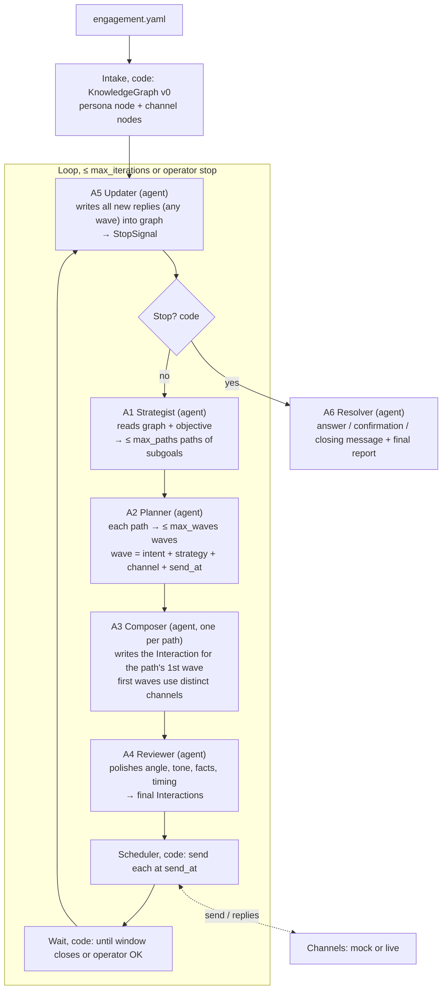

# Pequod???


Agentic, multi-wave, multi-channel engine that pursues one objective by engaging a persona across channels.

<p align="center">
  <!-- TODO: replace this placeholder with the Pequod banner image (e.g. docs/assets/pequod-banner.png) -->
  
</p>


**Contents**

1. [Repository structure](#repository-structure)
2. [Commands](#commands)
4. [How one run works](#how-one-run-works)
5. [Design](#design)
6. [Run it](#run-it)
7. [Customization](#customization)

## Repository structure

```
Revel8-Team_Case/
├── configs/                  # all settings (Hydra); nothing hard-coded in code
│   ├── angle/                # tones: authority, curiosity, familiarity, fear, urgency
│   ├── channels/             # system channels we send from: mock.yaml, live.yaml, mock_multi.yaml
│   ├── engagement/           # personas and their accounts (julius_muth.yaml)
│   ├── strategies/           # strategy catalogs (default.yaml)
│   ├── config.yaml           # models, agents, run limits, defaults list
│   └── sim.yaml              # browser-simulator settings
├── src/
│   ├── pequod/               # the engine
│   │   ├── agents/           # the six agents (strategist, planner, composer, reviewer, updater, resolver)
│   │   │   └── tools/        # graph, channel and strategy tools
│   │   ├── channels/         # email, sms, whatsapp (mock + live) and the mock hub
│   │   ├── models/           # provider adapters: anthropic, ollama, openai, vllm, huggingface
│   │   ├── visualizations/   # graph and report rendering
│   │   ├── engagement.py     # the wave loop (sends, waits, absorbs replies)
│   │   ├── graph.py          # the knowledge graph — a pure data structure, no agent code
│   │   ├── types.py          # agent output classes (Pydantic v2)
│   │   ├── strategies.py     # loads the strategy catalog
│   │   ├── trace.py          # per-run records
│   │   └── main.py           # the `pequod` entry point
│   └── pequod_sim/           # browser simulator — a separate program
├── tests/                    # pytest suite (fake models, fake servers, no network)
├── docs/                     # design, decisions, plans, reviews
├── runs/                     # one folder per run, written at runtime
├── pyproject.toml
└── README.md
```

## Commands

|Command | Summary|
|---|---|
| `uv run pequod` | Runs one engagement with the settings in `configs/`. |
| `uv run pequod <key>=<value> ...` | The same with settings changed for this run, for example `angle=empathy run.max_iterations=2`. |
| `uv run pequod --help` | Lists the config groups and the full config. |
| `uv run pequod reply <channel> "text"` | You answer as the persona on a mock channel. |
| `uv run pequod-sim` | Starts the browser simulator at `http://127.0.0.1:8000`. |
| `uv run pequod explain runs/<start time>` | Prints one card per wave of a run, then its report. |
| `uv run pequod check <channel> [overrides]` | Live channels: sends one test message. No model is used. |
| `uv run pequod check <channel> replies [overrides]` | Live channels: lists the replies of the last 24 hours. |
| `uv run pytest` | Runs the tests (fake models, fake servers, no network). |
| `uv run pytest -m live` | Calls each model in `configs/config.yaml` once for real. |


## How one run works

One run is a loop of iterations. In each iteration, six agents work in this order:

| Step | Agent | What it does | File |
|---|---|---|---|
| update | Updater | Writes what was sent and what the persona replied into the knowledge graph. Decides whether to stop. | `src/pequod/agents/updater.py` |
| plan | Strategist | Reads the graph and proposes up to `run.max_paths` paths (ordered subgoals). | `src/pequod/agents/strategist.py` |
| plan | Planner | Turns each path into up to `run.max_waves` waves: intent, strategy, channel, send time. | `src/pequod/agents/planner.py` |
| act | Composer | Writes the message for the first wave of each path. Each path gets its own channel. | `src/pequod/agents/composer.py` |
| act | Reviewer | Polishes all messages of the iteration together. | `src/pequod/agents/reviewer.py` |
| wait | (code) | Sends each message at its time, then waits for replies or for you. | `src/pequod/engagement.py` |
| resolve | Resolver | When the run stops: writes the report for the supervisor. Nothing is sent to the persona. | `src/pequod/agents/resolver.py` |

Only the first wave of each path is sent. The next iteration plans again from the updated graph.

The run stops when the persona meets the objective, accepts a proposal or opts out (decided by the Updater), when
`run.max_iterations` is reached, or when you stop it.


## Design



## Run it

### Setup

```
uv sync
```

### In the terminal (mock channels)

```
uv run pequod
```

```
uv run pequod reply whatsapp "Honestly, our stock numbers are a day old."
```

### In the browser (simulator)

The simulator is a page where you play the persona and follow the engine.

```
uv run pequod-sim
uv run pequod
```

The page only shows mock channels, it only works on mock mode.

### Live channels

Use `channels=live`.

| Channel | You need | Variables in `.env` |
|---|---|---|
| Email | A Gmail account with 2-step verification and an app password (Google account → Security → App passwords) | `EMAIL_ADDRESS`, `EMAIL_APP_PASSWORD` |
| SMS | A Twilio account and a Twilio phone number | `TWILIO_ACCOUNT_SID`, `TWILIO_AUTH_TOKEN`, `TWILIO_SMS_FROM` |
| WhatsApp | The Twilio WhatsApp sandbox; the recipient first sends the sandbox's join code to Twilio's number | `TWILIO_ACCOUNT_SID`, `TWILIO_AUTH_TOKEN`, `TWILIO_WHATSAPP_FROM` |

### Explain a run

Every run writes its record into its own folder, `runs/<start time>/`:

| File | Content |
|---|---|
| `trace.jsonl` | one line per wave: the paths, what was sent, the replies absorbed, the stop signal, the decision |
| `messages.jsonl` | every message sent and every reply received, in full, in the order they happened |
| `agents.jsonl` | one line per run of an agent: its prompt, the input, each model turn (text, reasoning, tool calls), each tool result, and the error if it gave no valid output |
| `status.json` | what the engine is doing right now (read by the simulator) |
| `graph_0.json`, `graph_1.json`, ... | the knowledge graph over time. `graph_0` is the start; `graph_<n>` is the graph after the replies of wave n were absorbed. Wave n was planned from `graph_<n-1>`. |
| `report.md` | the final report for the supervisor, with the stop reason on the first line |
| `main.log` | the log of the run, including every agent step |
| `.hydra/config.yaml` | the full config the run used |


## Customization

### Where things are

| You want to change | File | Reinstall? |
|---|---|---|
| The persona, the objective, their channels | `configs/engagement/<name>.yaml` | no |
| The tone of one channel | that channel's `angle:` in `configs/channels/*.yaml` (names a file in `configs/angle/`) | no |
| The wording of a tone | `configs/angle/<name>.yaml` | no |
| What an agent is told | `PROMPT` in `src/pequod/agents/<agent>.py` | no |
| What an agent must return | the classes in `src/pequod/types.py` | no |
| The catalog of strategies and their links | `configs/strategies/<name>.yaml` | no |
| Length and subject rules of a channel | `rules` in `configs/channels/mock.yaml` and `live.yaml` | no |
| A second account on a platform (e.g. a 2nd sender, or a 2nd persona mailbox) | a persona channel in `configs/engagement/<name>.yaml` and a system channel targeting it in `configs/channels/*.yaml` — config only, no code | no |
| Which model each agent uses, step limits | `agents` and `models` in `configs/config.yaml` | no |
| Loop limits, reply window | `run` in `configs/config.yaml` | no |
| A new Python package | `pyproject.toml` | `uv sync` |

Two ways to use a config change:

- **For one run:** on the command line. `uv run pequod angle=empathy run.max_iterations=3 agents.composer.max_steps=6`
- **As the new default:** edit the file, or the `defaults` list at the top of `configs/config.yaml`


### A new persona (engagement) and its channels

A run needs **two** files that fit together: the engagement (the persona and their own accounts) and a channels file
(the accounts we send from, each targeting one of the persona's accounts).

The engagement — the persona's accounts, each with a `platform`:

```yaml
# configs/engagement/acme.yaml
objective: "Find out which accounting software the persona uses."
persona:
  name: Jamie Rivera
  features:                 # free keys and values; all of them go into the knowledge graph
    role: Finance lead
    timezone: Europe/Madrid
    comms_style: formal
    notes: "Complained about invoice delays in March."
channels:                   # the persona's own accounts; every one needs a system channel below that targets it
  work_inbox:
    platform: email
    address: jamie@acme.example
    features: {hours: "09-13", notes: "prefers email"}   # free keys; the Planner reads them
  mobile:
    platform: whatsapp
    address: "+00 000 000"
    features: {hours: "10-18"}
```

```yaml
# configs/channels/acme_mock.yaml
me_finance:
  platform: email
  target: work_inbox        # must be a channel of configs/engagement/acme.yaml, and also email
  mode: mock
  role: "A finance vendor following up on a demo."
  angle: curiosity
  rules: {max_length: 2000, subject: true, links_ok: true}
hr:
  platform: whatsapp
  target: mobile
  mode: mock
  role: "A friendly contact from the persona's network."
  angle: familiarity
  rules: {max_length: 1000, subject: false, links_ok: true}
```

- Everything under `features` is free text for the agents. Nothing in code depends on the key names.
- `run.max_paths` must not be larger than the number of **system** channels (each path takes its own channel).

### Persona channels and system channels

Channels have two sides, in two files:

- **The persona's channels** (`configs/engagement/<name>.yaml`) are the persona's own accounts. Each has a **platform**
  (`email`, `sms` or `whatsapp`), an address and features.
- **The system's channels** (`configs/channels/*.yaml`) are pequod's accounts. Each has a platform, its own
  role/angle/rules/credentials, and a **`target`**: the persona channel it talks to. A system channel may only target a
  persona channel of the **same platform**, and several system channels may target the same persona account.


### The tone (angle), per channel

The angle is **per channel**, not one tone for the whole run: each channel can lean on a different tone. The library of
tones lives in `configs/angle/` (one file each: `authority`, `curiosity`, `familiarity`, `fear`, `urgency`), and every
channel names one with its `angle:` field in `configs/channels/*.yaml`.

### The strategies

A strategy is one way to make a contact. Every message is built on one. The catalog is `configs/strategies/default.yaml`.

### Who the engine writes as (role)

You state the role per **system channel** (our account), in the channel config: who we write as on that channel. It can be
any character or company. An empty role means "an assistant monitored by a human".

### Models and step limits

```yaml
# configs/config.yaml
models:
  ollama_qwen: {provider: ollama, name: "qwen2.5:14b", params: {num_ctx: 8192, temperature: 0}}
  claude: {provider: anthropic, name: claude-sonnet-5-5}
  # runs on Hugging Face's servers (needs HF_TOKEN)
  hf_qwen_hosted: {provider: huggingface, name: Qwen/Qwen2.5-72B-Instruct}
  # downloads the weights and runs on this machine
  hf_qwen_local: {provider: huggingface, name: Qwen/Qwen2.5-1.5B-Instruct, params: {local: true, family: qwen, pipeline_kwargs: {max_new_tokens: 512, do_sample: false}}}

agents:
  strategist: {model: ollama_qwen, max_steps: 4}
  updater:    {model: ollama_qwen, max_steps: 8}
```

- `models`: a free label → provider, model name, and `params` passed to the provider. Add as many as you like.
- `agents`: which label each agent uses, and its `max_steps` (the maximum number of model calls in one agent run; tool executions do not count).

### Loop limits

```yaml
# configs/config.yaml
run:
  max_iterations: 5     # iterations before the run stops by itself
  max_paths: 2          # paths (and so messages) per iteration; not more than the number of channels
  max_waves: 3          # waves planned per path (only the first is sent)
  reply_window_h: 24    # wait after the last send, unless you press Enter
  command_poll_s: 1     # how often the engine looks for the simulator's buttons
  register: true        # false = keep no record of the run
```
